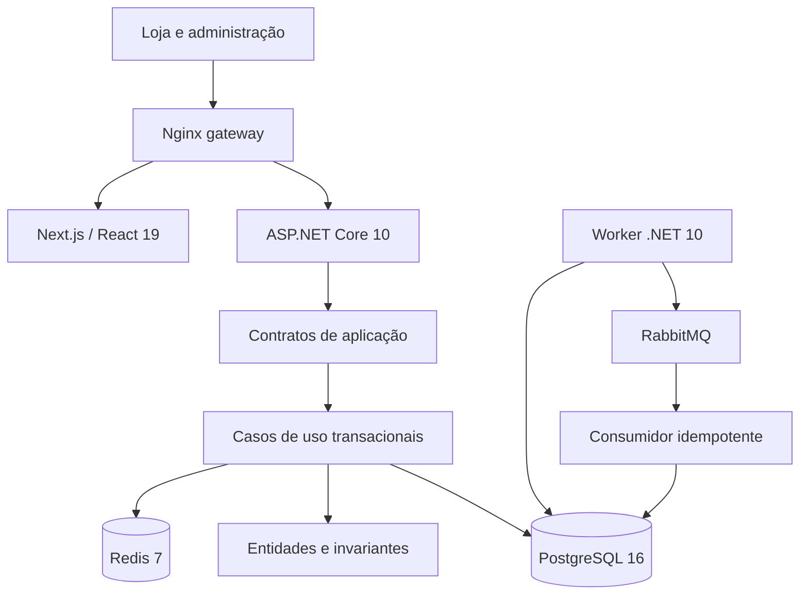

# Arquitetura da primeira versão

O diagrama mostra o fluxo de execução. As dependências de código seguem Api/Worker → Infrastructure → Application → Domain. Domain não conhece banco, cache, HTTP ou broker. A primeira versão organiza os casos de uso por contratos e concentra sua implementação transacional em Infrastructure; módulos separados por contexto podem ser extraídos conforme a aplicação crescer.

## Uma compra

1. O cookie assinado identifica a sessão; a API valida sua existência e o token CSRF.
2. O caso de uso obtém um advisory lock transacional derivado da sessão.
3. O banco fornece produto/preço e lotes elegíveis; FEFO escolhe os que vencem antes.
4. Reservas, pedido, movimentações e outbox são persistidos na mesma transação.
5. Após commit, o worker publica o evento com confirmação do RabbitMQ.
6. O consumidor registra o evento na inbox e confirma processamento. O ID evita efeitos duplicados.

Redis guarda apresentação do catálogo com TTL de 20 segundos. A disponibilidade não é cacheada, e a decisão de reserva sempre depende do PostgreSQL. Indisponibilidade do cache permite continuar pelo banco.

## Escopo da sessão

Cada sessão tem seus próprios produtos, pedidos, lotes e registros. As consultas incluem SessionId e os vínculos críticos usam chaves compostas para impedir associação entre sessões. A política administrativa exige o papel DemoAdministrator e ainda assim só permite agir dentro da sessão do cookie.

O isolamento demonstrativo não é uma solução completa de multiempresa: não há cadastro de empresas, usuários reais ou atribuição de papéis comerciais.

## Escolhas e limites

- API modular única e worker separado reduzem a operação inicial na VPS.
- Um lock por sessão simplifica a consistência do laboratório; não constitui uma medição de alta performance comercial.
- A fila de falhas exige inspeção/reprocessamento operacional. Não existe promessa de entrega exatamente uma vez.
- O banco e as filas são persistentes. O catálogo em Redis pode ser reconstruído.
- O fluxo de receita é inteiramente fictício. Não há uploads, diagnóstico ou decisão farmacêutica real.
- A publicação futura exige domínio, TLS, backups, dimensionamento e operação do servidor.
